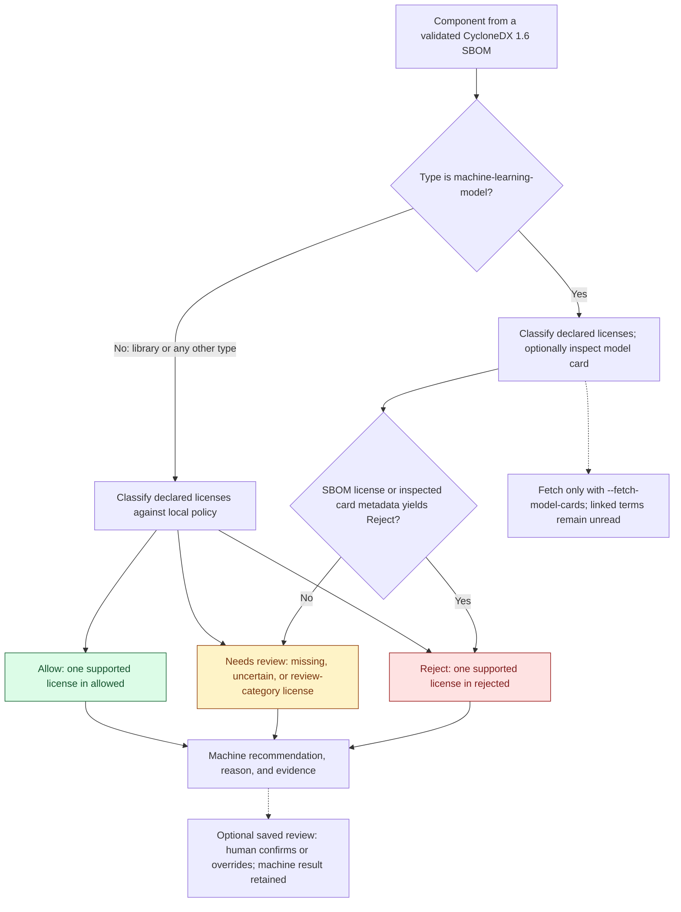

# SBOM Reviewer

First pass review of Software Bills of Materials (SBOMs) for legal acceleration.

## Component decision flow

Each component receives a machine recommendation: **Allow**, **Needs review**, or
**Reject**. The diagram shows the current behavior; **Allow** is a policy
recommendation, not a recorded human approval.



Models require manual review even with an allowed license, no external references,
or no detected restriction indicators. External references on other component
types do not trigger fetching or alter their license-policy result.

See the [detailed decision graphs](docs/decision-flow.md) for license matching,
model-card retrieval and evidence handling, and recorded human decisions.

## Development

Install Python 3.12 and [uv](https://docs.astral.sh/uv/), then install the locked dependencies:

```bash
uv sync --locked
```

Review a CycloneDX JSON **1.6** inventory against a local policy:

```bash
uv run --locked sbom-reviewer review samples/cyclonedx.json --policy policy/licenses.json
uv run --locked sbom-reviewer review samples/cyclonedx.json --policy policy/licenses.json > review.json
```

Help is available at both levels:

```bash
uv run --locked sbom-reviewer --help
uv run --locked sbom-reviewer review --help
```

Run the behavioral tests and strict dependency audit:

```bash
uv run --locked pytest
sh scripts/audit-dependencies.sh
```

The audit exports every locked runtime and development dependency with hashes,
excluding only the local editable application package. `pip-audit --strict`
fails on known vulnerabilities, lookup failures, and dependencies it cannot audit.

## Review behavior and limitations

The JSON result contains `policy_version`, ordered `results`, and summary counts.
Findings contain the original component JSON pointer, supplied `bom-ref`, name,
nullable version, type, all declared licenses, recommendation, reason, and source
references. The traversal visits `metadata.component` first, then the top-level
components and their children in depth-first input order. It ignores services and
dependency edges; it does not discover missing dependencies. Empty inventories
return zero findings. Repeated inputs produce identical output.

Recommendations are **Allow**, **Needs review**, or **Reject**. Completed reviews
exit **0**, even with rejected components. Missing arguments, unreadable files,
invalid JSON/policy/schema, and unsupported formats/versions exit **2**, with an
error on stderr and no review JSON. The dependency audit retains its separate
strict failure contract.

SBOM and policy JSON reject the nonstandard numeric tokens `NaN`, `Infinity`,
and `-Infinity` before schema validation. These words inside quoted strings remain
ordinary input data.
Both inputs allow at most **128 nested JSON object/array levels**, counting the root
container as level 1. Deeper inputs exit 2 with a nesting-limit message before
schema validation or deserialization; they never return a truncated review.

`policy/licenses.json` is an example company policy, not universal legal judgments.
All categories and a nonempty version are required; duplicate/overlapping entries,
extra fields, and wrong types are rejected. Categories may be empty. Matching is
case-sensitive and exact, for a single SPDX ID or an expression containing exactly
that ID. Missing evidence, custom licenses (use `license.name`), identifiers absent
from policy, multiple licenses, and compound expressions require review. No license
is inferred from descriptions, names, or URLs. Instructions within SBOM data cannot
change policy. Explicitly rejected model licenses remain Reject; every other model
requires manual review, including after model-card inspection.

Validation uses the library's bundled schemas and requires its `json-validation`
extra. The default review is local and deterministic: it needs no API keys or network
access. Opt-in model-card inspection is described below. Source URLs are HTTP(S) references
only; absent evidence has an explicit null URL and a declaration pointer. When an
SPDX ID has no supplied license URL, the result adds its canonical SPDX definition.
That definition does not independently verify the component's licensing.

The sample is an **illustrative product inventory**, not a claim about this
reviewer's dependencies. It has 13 components plus a metadata product, with expected
offline counts **14 total / 4 Allow / 9 Needs review / 1 Reject**. It includes the declared
Apache-2.0 `sentence-transformers/all-MiniLM-L6-v2` and MIT `BAAI/bge-small-en-v1.5`
models and `bigscience/bloom-560m` with a named BigScience RAIL license as an example
of custom/restricted licensing. The sample's declarations and links are illustrative,
unverified input evidence, not independently verified licensing advice.

## Opt-in model-card inspection

```bash
uv run --locked sbom-reviewer review samples/cyclonedx.json --policy policy/licenses.json --fetch-model-cards
```

Only `machine-learning-model` components are fetched, sequentially, using their SBOM
model-card references. Duplicate URLs collapse; ambiguous references require review.
Supported sources are public HTTPS URLs on exactly `huggingface.co`: `/owner/repo`,
`/owner/repo/blob/revision/README.md`, or `/owner/repo/raw/revision/README.md`.
Repository pages use `raw/main/README.md`; blob links use raw Markdown. Owner, repository,
and revision must be single segments of letters, digits, `.`, `_`, or `-`, excluding
`.` and `..`. Encoded segments, other Hub resources, credentials, queries, fragments,
and ports other than 443 are unsupported. Redirects are blocked. Each request has a
5-second socket timeout, no retries, and a 1 MiB response limit. Cards must be UTF-8
text; HTML is rejected.

Each result adds nullable `model_assessment` (null on the default path and for
non-models). Inspected cards record their retrieval URL, downloaded-byte SHA-256,
original and normalized metadata license, a separate `license_policy_decision`, and
ordered findings with verbatim excerpts and inclusive source line ranges.
`license_evidence` retains the metadata lines for policy conflict provenance.
Safe YAML parsing rejects duplicate keys, unsafe tags, and YAML aliases before
expansion. Alias-based metadata produces `invalid_metadata`; supported prose is
still collected. Missing, malformed, custom,
unknown, or restricted metadata remains explicit evidence for Legal.
Missing/unsupported references and retrieval failures produce component findings;
review still emits complete JSON and exits 0, with no unrelated stderr warnings.

The deterministic parser collects selected license/usage sections and scans prose
outside fenced code for a limited set of potential restriction indicators. Technical
limitations and intended-use passages are context, not legal prohibitions. Keyword
matches never automatically reject a model; an explicitly rejected SBOM or supported
card metadata license can produce Reject. An allowed license label, missing SBOM
evidence, or no supported indicators still requires manual review. Instructions in
external text cannot change policy or execute tools. Runtime AI is not implemented;
there is no model API or semantic interpretation of arbitrary legal text.

HTTP(S) license and acceptable-use links in selected sections and `license_link`
metadata are preserved in `sources`, pointing to the originating SBOM model-card
reference. They receive `referenced_terms_unread` findings: their documents are not
recursively fetched or assessed. Live cards may change; repeated results are
deterministic for the same downloaded documents. A `main` card does not verify a
particular weights revision. These are conservative evidence flags; Legal determines
the meaning of the terms and whether the intended product use is acceptable.

These are preliminary policy recommendations, not human approvals or a statement
of CRA compliance. This version does not evaluate Boolean
license expressions, license compatibility, vulnerabilities, or SPDX documents.

## Saved reviews and reviewer decisions

For a two-component rehearsal with an offline card fixture, SQLite inspection,
and successive reports, follow [the presentation walkthrough](presentation/COMMANDS.md).

Save a complete machine review to a **new** SQLite file, record individual human
actions, inspect the resulting JSON, and export a standalone HTML report:

```bash
uv run --locked sbom-reviewer review samples/cyclonedx.json --policy policy/licenses.json --save-review review.sqlite
uv run --locked sbom-reviewer show review.sqlite
uv run --locked sbom-reviewer decide review.sqlite --component '#/components/0' --confirm --reviewer 'Example Reviewer' --reason 'Reviewed the supplied declaration and agree with the recommendation.'
uv run --locked sbom-reviewer decide review.sqlite --component '#/components/10' --override Allow --reviewer 'Example Reviewer' --reason 'Illustrative reviewer override for the demo; actual licensing remains to be verified.'
uv run --locked sbom-reviewer show review.sqlite
uv run --locked sbom-reviewer export review.sqlite --output review.html
```

The sample initially has **14 total / 4 Allow / 9 Needs review / 1 Reject** machine
recommendations and **0 recorded / 14 pending** human decisions. The two illustrative
actions above produce **2 recorded / 12 pending / 2 Allow / 0 Needs review / 0 Reject**
human counts. Machine recommendations and evidence stay unchanged. These example
decisions demonstrate the workflow, not verified licensing of the sample inventory.

**Confirm recommendation** records the original machine outcome, including Reject
or Needs review. It always refers to the saved snapshot, even after an override.
An override must differ from the machine outcome; use `--override 'Needs review'`
for outcomes containing spaces. Both actions require a nonblank reviewer and
rationale. Components without an event remain **Pending human review**, including
those with machine Allow. A recorded Needs review remains unresolved.

Each action appends a timestamped event with an increasing ID. `show` includes the
original `snapshot`, `saved_at`, current `reviewer_decisions` in component order,
the full `audit_log` in event order, and separate `reviewer_summary` counts.
Earlier events are retained; event IDs determine the latest action. Components
with identical names have separate histories keyed by their exact JSON pointers.
Use a new database for a fresh machine review; decisions do not carry over.

`review --save-review` still emits the existing review JSON, after the snapshot
commits. Without the flag, review opens no database. Saving also works with
`--fetch-model-cards`; only that explicit review flag permits evidence retrieval.
`decide` emits just the committed event JSON, `show` emits the saved view, and
`export` writes UTF-8 HTML with empty stdout. Successful commands exit 0 even with
Reject or Needs review. Invalid arguments, invalid/missing databases, unsupported
schema versions, and expected storage/output failures exit 2 with a stderr error.
Existing database and report paths are never overwritten.

Open `review.html` locally or attach it to a review handoff. The report needs no
server, scripts, external assets, or network fetches, and can be printed through
the browser. It includes original evidence and sources, current human decisions,
pending components, and superseded history. Supplied text is escaped; only valid
HTTP(S) references become clickable. Unavailable cards and unread linked terms
remain explicit. Repeated exports of the same saved state produce identical HTML.

This is a local demonstration workflow. Reviewer names are supplied by the caller,
without authentication. Append-only history is enforced by the application and
does not prevent someone editing SQLite directly. Browser review, collaboration,
bulk decisions, signing, and direct PDF generation are outside this version.
Neither a recorded action nor the report establishes automatic legal approval,
verified licensing, or CRA compliance.

## Agent workflow

Read [AGENTS.md](AGENTS.md) and the relevant story before implementation. Work on
one story at a time, add behavioral tests for its acceptance criteria, and report
the commands run and any remaining limitations.

## Local Jenkins

The repository includes a local Jenkins controller and Python 3.12 agent. Follow
the setup instructions in [docs/local-jenkins.md](docs/local-jenkins.md).
Jenkins is bound to `127.0.0.1:8080` and is intended for local use only.
