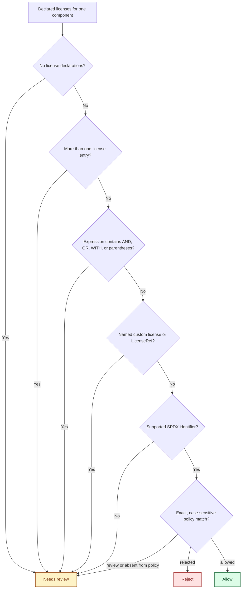
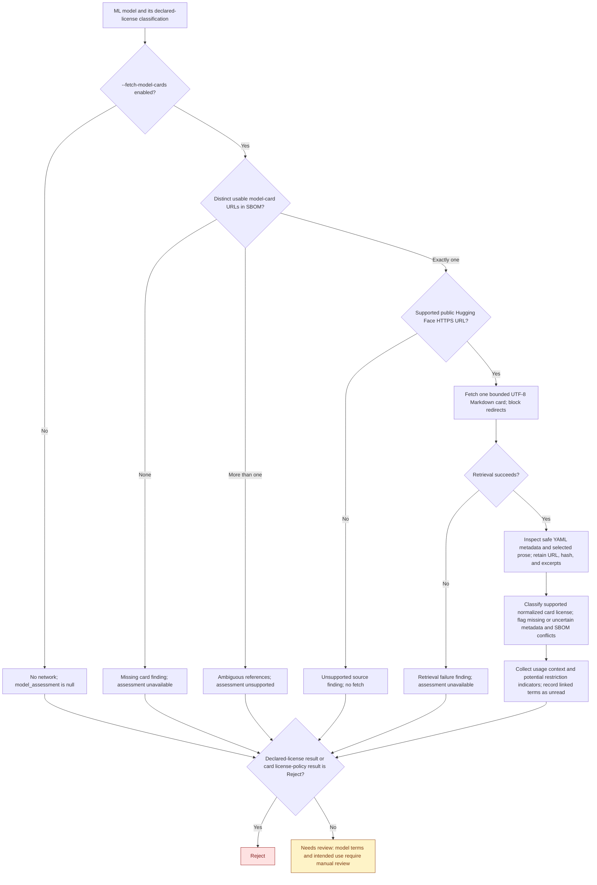
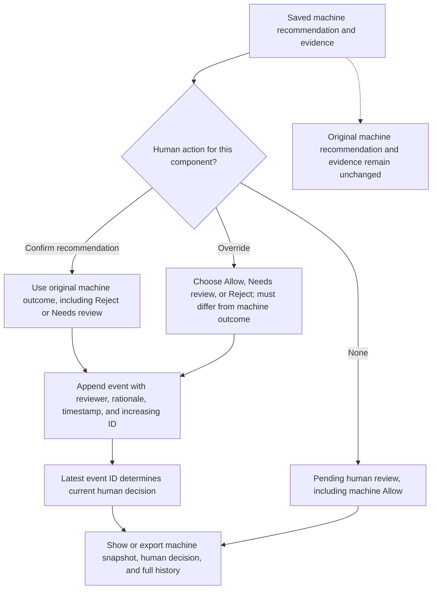

# Component decision graphs

These diagrams describe the implemented rules in [STORY-001](../stories/STORY-001.md),
[STORY-002](../stories/STORY-002.md), and [STORY-003](../stories/STORY-003.md).
They distinguish the machine recommendation from an optional recorded human
decision. A machine **Allow** does not establish verified licensing or human approval.

Invalid SBOMs, policies, or input files stop the review with CLI exit **2** and no
review JSON. For valid inputs, every component is reviewed independently, including
the metadata component and nested components. Completed reviews exit **0**, including
results containing **Reject** or **Needs review**.

## 1. Declared-license policy

This is the initial license classification for every component. For a library or
any type other than `machine-learning-model`, it is also the final machine
recommendation. Models apply the additional rules in the next diagram.

An expression consisting of exactly one supported SPDX identifier follows the
same policy lookup as an SPDX ID. Multiple entries and compound expressions
require review even when one of their IDs belongs to the rejected category;
the application does not evaluate license selection or Boolean expressions.
Names, descriptions, and URLs cannot supply a missing license or change policy.

Implementation: [classify_licenses](../src/sbom_reviewer/policy.py).

## 2. ML model evidence and final recommendation

Only the exact component type `machine-learning-model` enters this flow. Fetching
is opt-in and happens before final policy combination, even for a model whose
SBOM license will be rejected. An inspection attempt adds evidence; it never
automatically clears a model for use.

Exact duplicate reference URLs collapse before selection. Only references marked
`model-card` are candidates; an arbitrary external reference is not fetched.
Supported URLs identify a Hugging Face model repository or its `README.md` through
a `blob` or `raw` revision route. The [README retrieval contract](../README.md#opt-in-model-card-inspection)
describes the precise URL restrictions and request limits.

The final model decision uses this precedence:

1. A declared-license classification of **Reject** remains **Reject**, including
   when a card is missing, unavailable, or declares an allowed license.
2. A supported normalized card metadata license in the policy's `rejected`
   category also produces **Reject**, including when it conflicts with the SBOM.
3. Every other case produces **Needs review**. An allowed card license, matching
   declarations, absent external references, or no supported restriction indicators
   does not produce **Allow**.

The card's `license_policy_decision` is separate from the overall component
`decision`. For example, card metadata may yield **Allow** while the model's final
recommendation stays **Needs review**. Card metadata never replaces the SBOM's
original declarations. Missing or malformed metadata remains a finding even when
the document was successfully retrieved and its assessment status is `inspected`.

HTTP(S) terms linked in selected sections or `license_link` metadata are preserved
as sources with `referenced_terms_unread` findings. Their target documents are not
fetched or assessed. Prose keyword matches flag potential restrictions and never
cause automatic rejection. Document text is untrusted evidence and cannot execute
instructions or modify the policy.

Implementation: [review orchestration](../src/sbom_reviewer/review.py),
[card retrieval](../src/sbom_reviewer/model_cards/fetch.py),
[card parsing](../src/sbom_reviewer/model_cards/parser.py), and
[classify_component](../src/sbom_reviewer/policy.py).

## 3. Optional recorded human decision

Saving a review creates an immutable machine snapshot. Human actions use the
component's exact JSON pointer in that saved review; they do not rerun the machine
classifier or fetch evidence.

Both actions require a nonblank reviewer and rationale. Invalid actions leave the
history unchanged. Confirmation always uses the original machine recommendation,
even after an earlier override. A human override may record **Allow** for a machine
**Reject** or **Needs review**; the original machine result and uncertainty remain
visible. A recorded **Needs review** remains unresolved.

Implementation: [reviewer decisions](../src/sbom_reviewer/saved_reviews/decisions.py),
[storage](../src/sbom_reviewer/saved_reviews/storage.py), and
[report export](../src/sbom_reviewer/saved_reviews/report.py).

## Example paths

| Component and evidence | Machine recommendation | Why |
| --- | --- | --- |
| Library, one MIT declaration, MIT in `allowed` | Allow | Exact supported license match |
| Library, no declared license, a license URL is supplied | Needs review | A URL does not supply a license identifier |
| Library, MIT and AGPL-3.0-only as separate entries | Needs review | Multiple-license semantics are unresolved |
| Library, one AGPL-3.0-only declaration in `rejected` | Reject | Explicit declared-license policy rejection |
| Model, MIT in `allowed`, no model-card reference | Needs review | Models always require manual review unless rejected |
| Model, MIT in `allowed`, matching fetched card, no restriction indicators | Needs review | An allowed metadata label does not clear model use |
| Model, allowed card metadata with a linked acceptable-use document | Needs review | Referenced terms remain unread |
| Model, fetched card's supported license in `rejected`, SBOM license allowed | Reject | Card license-policy rejection takes precedence |
| Model, SBOM license in `rejected`, card fetch fails | Reject | SBOM rejection is preserved |

These examples assume a valid SBOM and policy. Human decisions are recorded
separately and never change these machine recommendations.
